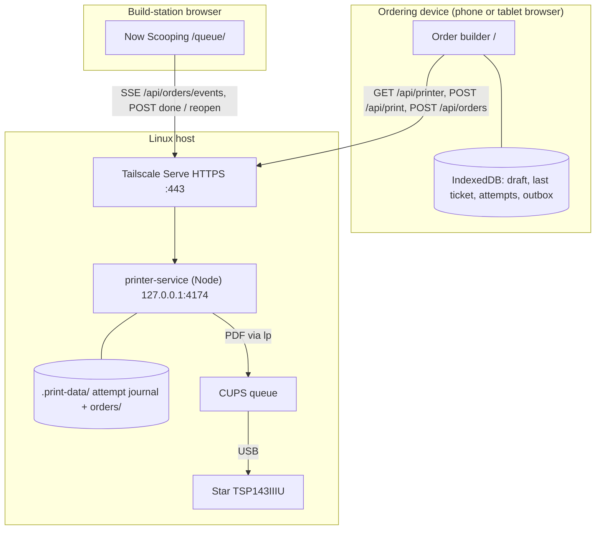

# Fiona's Order Pad

Touch-friendly order entry for an ice cream stand. Staff build each customer's order on a phone or tablet, a USB receipt printer attached to a Linux server prints a preparation ticket, and a second screen, **Now Scooping**, shows the build station which orders are still open. There are no prices, payments or user accounts.

The app is a prerendered SvelteKit 2 / Svelte 5 PWA written in TypeScript. A small Node service on the Linux host serves it, prints through CUPS and keeps the shared order queue.

> **Coding agents and new contributors:** start with [AGENTS.md](AGENTS.md). It lists the invariants that must not break, where each concern lives, and how to verify a change.

## How it fits together



- **Ordering device** opens the Linux host's HTTPS URL in a browser. The draft, the last submitted ticket and its print attempts live in that browser's IndexedDB, so they survive reloads.
- **Linux host** runs `printer-service/`. It serves the static app from `build/`, renders each ticket as a PDF, submits it with `lp` to a local CUPS queue, and stores the shared order list on disk. Tailscale Serve provides private HTTPS on the tailnet.
- **Build station** opens `/queue/` on the same origin and receives live updates over Server-Sent Events (SSE).

The only supported print path from the UI is the Linux service. The repository also contains simulated and Android PassPRNT adapters; they are kept for unit tests and history and cannot be selected in the interface.

**Station status.** The verified station (2026-10-11) is Linux Mint 22.3 with Node 24, the CUPS queue `Star_TSP143` using the Star TSP100 Cutter driver, and a Galaxy S10e as the ordering device over Tailscale HTTPS. The owner reported a successful CUPS test page and successful Order Pad prints from that phone, including a built order. The detailed physical acceptance checklist (layout, REPRINT, interruptions and recovery) is not yet recorded as complete. See [docs/linux-printing.md](docs/linux-printing.md).

## Quick start (development)

Requirements: Node 22.17 or later (CI uses Node 24) and npm.

```sh
npm ci
npm run dev
```

The dev server listens on port 5173 on all interfaces (`--host 0.0.0.0`), so other devices on your network can reach it.

There is no in-app printer simulator, and the dev server has no `/api` routes. Expect this during development:

- The builder shows **Printer unavailable** and **Print order** stays disabled.
- **Now Scooping** is hidden in Order tools, and `/queue/` shows **Queue needs attention**.
- Building, editing and reloading drafts all work.

Full print and queue flows run in the Playwright suite, which mocks the API or starts the real HTTP service with a stubbed CUPS. The real service runs only on Linux and needs a local USB CUPS queue and an HTTPS origin (see [Configuration](#configuration)).

## Commands

| Command                           | What it does                                                                                                                                    |
| --------------------------------- | ----------------------------------------------------------------------------------------------------------------------------------------------- |
| `npm run dev`                     | Vite dev server for the UI (port 5173, all interfaces).                                                                                         |
| `npm run check`                   | `svelte-kit sync`, `svelte-check` for the app, then `tsc -p tsconfig.printer.json` for `printer-service/`.                                      |
| `npm run lint`                    | Prettier check of the whole repository. `npm run format` rewrites files.                                                                        |
| `npm test`                        | Vitest unit and HTTP tests (`src/**/*.test.ts`, `printer-service/**/*.test.ts`). `npm run test:watch` re-runs on change.                        |
| `npm run build`                   | Static app and service worker into `build/`.                                                                                                    |
| `npm run build:printer`           | Bundles the Linux service into `build-printer/server.mjs`.                                                                                      |
| `npm run start:printer`           | Runs the bundled service. Linux only; run it from the repository root (see [Configuration](#configuration)).                                    |
| `npm run preview`                 | Serves `build/` with Vite on port 4173. Like `dev`, it has no `/api` routes.                                                                    |
| `npx playwright install chromium` | One-time browser download for the end-to-end tests.                                                                                             |
| `npm run test:e2e`                | Playwright against `vite preview` on port 4175. **Run `npm run build` first**: both the preview server and the live-queue tests serve `build/`. |

To run everything CI runs, in CI's order:

```sh
npm ci
npm run check
npm run lint
npm test
npm run build
npm run build:printer
npx playwright install chromium
npm run test:e2e
```

CI ([.github/workflows/checks.yml](.github/workflows/checks.yml)) runs these on Node 24 for every pull request and every push to `main`, with `--with-deps` on the Playwright install. To check a branch that has no pull request, start the workflow manually from the Actions tab. Browser tests run in desktop Chromium. They do not replace testing on the Android phone and printer. The lockfile pins dependencies, and the `cookie` override in `package.json` resolves an upstream SvelteKit 2 advisory.

## Project layout

```text
src/
  lib/tickets/        Menu, draft editing, ticket validation, receipt layout (pure: no DOM, I/O or transport)
  lib/printing/       Print port, PrintSession (intent saved before every send), printer adapters
  lib/storage/        IndexedDB store: drafts, tickets, attempts, queue outbox, reference counter
  lib/orders/         Queue order model, API client, SSE feed, outbox publisher, column packing
  lib/app-update.ts   Applies service-worker updates only when it is safe to reload
  lib/builder.css     Global component styles and local Poppins @font-face rules
  routes/+layout.*    Prerendering, design-token injection, update checks
  routes/+page.svelte         Order builder (/)
  routes/queue/+page.svelte   Now Scooping (/queue/)
  service-worker/     Versioned offline shell cache (own tsconfig; excluded from the root project)
printer-service/      Linux Node service: HTTP API, static hosting, CUPS, PDF, print journal, order store, SSE
tests/                Playwright specs (app.spec.ts, queue.spec.ts, queue-live.spec.ts)
static/               Poppins fonts, logo, icons, web app manifest
design/               Design handoff (brief, reference screens, tokens). tokens/tokens.css ships in the app.
docs/                 Station setup, hardware notes, verification log
```

## Using the order builder

### Menu and rules

A **serving** is one cup or cone.

- **Flavors:** Chocolate, Vanilla, Strawberry, Chocolate Chip. Flavors can be mixed in one serving.
- **Scoops:** 1–5 per serving, counted across all its flavors. Every count starts at zero.
- **Container:** exactly one of Cup, Cake Cone or Sugar Cone. Nothing is preselected.
- **Toppings (optional):** any combination of Whipped cream, Gummy Bears, Caramel Sauce, Chocolate Sauce, Sliced Almonds, Maraschino Cherries, Rainbow Sprinkles and Chocolate Sprinkles.

An **order** has 1–30 servings, as long as the ticket fits the receipt limits (240 text lines and 2000 mm, with room reserved for a REPRINT banner). An order that is too long blocks printing with a message. The customer name is optional, up to 80 printable characters, with control characters removed. A blank name becomes a stable two-word label derived from the order number, such as **Sunny Caramel** for #0043. The label is resolved once and stored on the ticket.

The menu is defined in [src/lib/tickets/ticket.ts](src/lib/tickets/ticket.ts). The design brief in [design/IMPLEMENTATION.md](design/IMPLEMENTATION.md) has the full ordering rules.

### Building and printing

1. Use the **+ / −** buttons to set scoops for one or more flavors. At five scoops every **+** is disabled until you remove one.
2. Choose a container and any toppings.
3. For a one-serving order, tap **Print order**. Printing includes the serving you are still editing.
4. For more servings, tap **Add serving** after each one, then print after configuring the last. The button reads **Print order · N servings** when there is more than one.

You can tap a saved serving to edit it. While editing, **Add serving** becomes **Save serving** and **Cancel serving** becomes **Cancel edit**. If you print while editing, the edited serving replaces the original; it is never duplicated. A serving with no scoops or no container blocks printing until you finish or cancel it. Tapping a saved serving while a new one is half-built does nothing, so the unfinished serving is not lost.

The header shows the current order number and a **Reprint last order** button. **Order tools**, collapsed by default, contains:

- the **Now Scooping** link, when order tracking is on;
- **Printer settings**: the CUPS queue, a readiness message, **Check printer** and setup notes;
- a ticket preview for the current draft;
- the last submitted order, its receipt and its print attempts;
- **New order**, which clears the current draft.

Opening or closing Order tools never changes the draft. The app checks printer readiness when it loads and when Order tools opens. No printer selection or setup confirmation is needed.

### The prep ticket

Each ticket has a header with the date and time (`Sun 10/11 · 7:42 PM`), a large `#0043` order number, the display name, and totals (`3 SERVINGS | 7 SCOOPS`). One block follows per serving, then `END OF TICKET` and the ticket ID. Each serving block has a tick box with `SERVING 1 OF 3`, a black scoop-count tag beside the container (`[3] SCOOPS · CUP`), one line per flavor (`2 × Chocolate Chip`), and its toppings or **No toppings**. Flavors and toppings always print in menu order. For example, a cup with 2 Chocolate Chip and 1 Strawberry is one serving: `[3] SCOOPS · CUP`, then `1 × Strawberry`, then `2 × Chocolate Chip`. Reprints start with an inverse **REPRINT** banner reading "Check for the first copy before building".

The Linux service renders the PDF, so printed times use **the Linux host's local time zone**. The ticket preview in Order tools uses the browser's time zone and a plain-text layout (`3 SCOOPS - CUP`, `1 x Strawberry`).

### After printing

- **Accepted:** the next empty order opens immediately with the next number. A toast such as "Order #0043 sent to the printer · Maria · 3 servings · 7 scoops" offers **Reprint** and disappears after six seconds.
- **Failed** (nothing was submitted) or **outcome unknown** (the job may or may not have printed): the order stays locked with a recovery panel offering **Reprint saved order** and **New order**, and an error toast stays until you dismiss it. An unknown outcome requires checking the physical output and pending CUPS jobs, then ticking **I checked the output and am ready to continue**, before you can reprint or start a new order. Nothing is ever resent automatically.
- **Reprint last order** prints the previous ticket again with the same ticket ID, number, name and timestamp, plus the REPRINT banner. It never changes the draft you are currently building.

## Now Scooping (build queue)

Open **Now Scooping** from Order tools, or browse to `/queue/` on the same HTTPS origin from the build-station tablet. The queue depends on the Linux service. A static host or the dev server cannot show it.

- Open orders appear oldest first. The header shows counts of open orders, servings to build and the oldest wait.
- Each card shows the order number, display name, time placed and a wait badge: moss under 5 minutes, olive from 5 to 10, rust at 10 or more. Ages refresh at least every 30 seconds.
- Each serving lists its flavors as rounded chips with a count bubble, and its toppings as separate outlined chips with a `+` icon. A serving without toppings shows a dashed **No toppings** chip.
- **Mark #0043 done** takes one tap with no confirmation. The **Recently done** strip keeps the latest eight completed orders with **Undo**.
- Cards are packed into 1, 2, 3 or 4 columns depending on the content width (below 640, 1000 and 1500 px, otherwise 4). Each card goes into the currently shortest column by measured height, leftmost on ties, so short cards leave no gaps. Cards re-pack only when the set of open orders or the column count changes, never on the 30-second refresh. `aria-posinset` and `aria-setsize` keep screen readers in age order.

**Live updates.** On connect, the service sends `retry: 3000` and a complete snapshot, then a new snapshot after every saved change, and a `ping` every 15 seconds. If the browser receives nothing for 45 seconds, it reconnects and shows a warning. There is no event replay and no polling fallback. Each service process has an instance ID and each snapshot a revision, so a delayed snapshot or action response cannot overwrite newer state. On a connection error the last list stays visible with **Reconnecting…** and **Refresh queue**. A failed first load never shows the empty state. Done and Undo keep working while the stream is down, as long as their POST requests succeed. Action errors stay visible until a later action succeeds or you refresh.

**What creates a card.** An order is registered on its **first** print submission, even if that print then fails or its outcome is unknown, so a card is not proof that a ticket printed. Orders are keyed by the immutable ticket ID. Repeat registrations are no-ops, reprints never add or reopen a card, and only **Undo** reopens a done order. Completed orders stay on disk after they leave the Recently done strip. Prints made before tracking existed, or while it was off, are never backfilled.

Registration happens in two places:

1. `POST /api/print` registers the order on the server before printing, when tracking is on and the request is not a reprint. If that fails, printing still continues.
2. The browser saves the ticket to an IndexedDB outbox in the same transaction as its print intent. Every five seconds it publishes pending entries to `POST /api/orders` until they are acknowledged. The outbox survives reloads and never calls `/api/print`.

## Optional order tracking

Tracking is on by default. For an event that only needs printed tickets, start the service with tracking off:

```sh
export ORDER_PAD_TRACKING_ENABLED=false
npm run start:printer
```

The value must be exactly `true` or `false`; anything else stops the service at startup. Restart the service and reload open tabs after changing it. No rebuild is needed.

While tracking is off:

- the builder hides Now Scooping and `/queue/` shows "Order tracking is turned off";
- `/api/orders` and its SSE endpoint return 404 with code `ORDER_TRACKING_DISABLED`;
- printing, reprints, drafts, recovery and order numbers work normally;
- saved server orders and the print journal are left untouched.

A browser that learns tracking is off discards its pending queue publications. It keeps its tickets, attempts and drafts. It finds out when it next checks the printer, or within about five seconds if its outbox is running. An open queue stops its stream when it detects the change. Set `true` (or unset the variable), restart and reload to resume. Orders printed while tracking was off are not imported later.

## Printing and reliability

Every print attempt ends in one of three results:

| Result            | Meaning                                                                                                                                                                   |
| ----------------- | ------------------------------------------------------------------------------------------------------------------------------------------------------------------------- |
| `accepted`        | CUPS accepted the job into its queue. This is not proof of physical output: paper, cover or cable problems can still happen afterwards, and a queued job may print later. |
| `failed`          | Rejected before submission, for example by an invalid ticket, a pending CUPS job, a busy service or an unsuitable queue. No job was sent.                                 |
| `outcome-unknown` | The send was interrupted, its response was lost or malformed, or its result could not be saved. The ticket may or may not have printed.                                   |

These rules hold across the browser and the service:

- **Intent before send.** The browser saves the ticket and a pending attempt to IndexedDB before calling the service. The service writes and syncs its own journal entry before running `lp`. If storage fails, nothing is sent.
- **No automatic retries.** A pending attempt found after a reload or service restart becomes `outcome-unknown` and is never replayed. Repeating an attempt ID returns the saved result. Reusing an attempt ID with different content is rejected.
- **Final results are final.** A late or repeated report cannot change a completed attempt.
- **Tickets are immutable.** A reprint is a new attempt for the same ticket, marked REPRINT. It is never a new ticket.
- **One submission at a time.** The service refuses a new job while another submission is running or while the CUPS queue has a pending job. Inspect the printer and `lpstat -o` before reprinting.
- **One ordering tab per device.** Order numbers come from a per-browser counter, so use one order-taking station. The queue can be open on any number of devices.

There is no background print queue, cloud backup or exactly-once guarantee. Other applications that print through CUPS bypass the service's lock.

## Configuration

The service reads its configuration from environment variables at startup:

| Variable                     | Default                                               | Notes                                                                                                                              |
| ---------------------------- | ----------------------------------------------------- | ---------------------------------------------------------------------------------------------------------------------------------- |
| `ORDER_PAD_ORIGIN`           | _required_                                            | Root HTTPS origin the browsers use, such as `https://host.tailnet.ts.net`. It must be `https:` with no path, query or credentials. |
| `ORDER_PAD_QUEUE`            | `OrderPad`                                            | Name of the local USB CUPS queue. The verified station uses `Star_TSP143`.                                                         |
| `ORDER_PAD_PORT`             | `4174`                                                | Loopback port (1024–65535). The service binds to `127.0.0.1` only.                                                                 |
| `ORDER_PAD_DATA`             | `.print-data`                                         | Journal directory. Relative paths resolve from the working directory.                                                              |
| `ORDER_PAD_FONT`             | `/usr/share/fonts/truetype/dejavu/DejaVuSansMono.ttf` | Font embedded in receipt PDFs (`apt install fonts-dejavu-core`).                                                                   |
| `ORDER_PAD_TRACKING_ENABLED` | `true`                                                | Exactly `true` or `false`. See [Optional order tracking](#optional-order-tracking).                                                |

**Start the service from the repository root.** It serves `./build` and resolves a relative `ORDER_PAD_DATA` from the current directory. Keep paths and environment the same across restarts.

Requests must use the configured origin. The `Host` header must match `ORDER_PAD_ORIGIN`, `127.0.0.1:PORT` or `localhost:PORT`. POST requests must send `Origin` equal to `ORDER_PAD_ORIGIN` and `Content-Type: application/json`. Request bodies are limited to 128 KiB, and no CORS headers are sent. Access control is left to the tailnet; there is no login. Station setup, Tailscale Serve, CUPS options and the physical acceptance checklist are in [docs/linux-printing.md](docs/linux-printing.md).

## HTTP API

All `/api` responses are JSON with `Cache-Control: no-store`, except the SSE stream. Shared types live in [src/lib/printing/port.ts](src/lib/printing/port.ts), [src/lib/tickets/ticket.ts](src/lib/tickets/ticket.ts) and [src/lib/orders/](src/lib/orders/).

| Endpoint                      | Request                                                                      | Response                                                                                                                                                                                                     |
| ----------------------------- | ---------------------------------------------------------------------------- | ------------------------------------------------------------------------------------------------------------------------------------------------------------------------------------------------------------ |
| `GET /api/printer`            | none                                                                         | Always 200: `{ ready, queue, message }`. Checks that the queue exists, is enabled, uses `usb://` and offers the Star variable-length and cut options.                                                        |
| `POST /api/print`             | `{ ticket, attemptId, reprint }`; `attemptId` matches `[A-Za-z0-9_-]{1,100}` | 200 `{ attemptId, result }`, where `result` is a `PrintAttemptResult`. Print failures are 200 with `result.status` of `failed` or `outcome-unknown`; 400 means the request was invalid and nothing was sent. |
| `GET /api/features`           | none                                                                         | `{ trackingEnabled }`, the setting the service is running with. Always available.                                                                                                                            |
| `POST /api/orders`            | schema 2 ticket                                                              | `{ order, created }`: 201 when first created, 200 when the ID already exists (unchanged).                                                                                                                    |
| `GET /api/orders`             | optional `?status=open` or `?status=done`                                    | `{ orders }`: open orders oldest first, then the eight most recently done. `status` filters to one of the two lists.                                                                                         |
| `GET /api/orders/events`      | none (`EventSource`)                                                         | SSE. `orders` events carry `{ orders, instanceId, revision }`; `ping` events every 15 s.                                                                                                                     |
| `POST /api/orders/:id/done`   | `{}`                                                                         | `{ order, instanceId, revision }`. Idempotent.                                                                                                                                                               |
| `POST /api/orders/:id/reopen` | `{}`                                                                         | `{ order, instanceId, revision }`. Idempotent; keeps the original submission time.                                                                                                                           |

A queue order is `{ ticket, submittedAt, status: 'open' | 'done', doneAt? }`. `submittedAt` is the ticket's own `createdAt`, so a delayed publication does not reset its wait time. With tracking off, every `/api/orders` route returns 404 with `code: "ORDER_TRACKING_DISABLED"`. Unknown order IDs return 404 and an unavailable order store returns 503. Any other non-`/api` GET or HEAD request serves a file from `build/`. Files under `/_app/immutable/` are cached for a year; everything else is `no-cache`.

## Data and persistence

**Browser (per origin and profile).** IndexedDB database `order-pad-v1`, schema version 2:

| Store      | Contents                                                                                                                                     |
| ---------- | -------------------------------------------------------------------------------------------------------------------------------------------- |
| `tickets`  | Immutable schema 2 tickets, keyed by `id`.                                                                                                   |
| `attempts` | Print attempts (`id`, `ticketId`, `mode`, `reprint`, `startedAt`, then `result` and `completedAt` when finished).                            |
| `settings` | `latest` (ticket ID), `draft` (current draft), `referenceCounter` (highest order number issued), and `queueOrder:<ticketId>` outbox entries. |

A new order's ticket, locked draft, counter, first attempt and (with tracking on) outbox entry are written in one transaction. An accepted result and the next empty draft are also written together. Clearing site data, switching browser profile or changing the URL origin loses this history. If storage is missing or a write fails, printing is blocked.

**Linux service (`ORDER_PAD_DATA`, default `.print-data/`, Git-ignored).**

- `<attemptId>.json` holds one file per print attempt: `{ request, result? }`. It is created exclusively and synced before `lp` runs, then replaced atomically with the result.
- `orders/<sha256(ticketId)>.json` holds one file per queue order, written atomically.

One service process owns these files. Back them up, keep them across updates and restarts, and never delete them to resolve an ambiguous print.

## Updates and offline use

After one online visit, the service worker caches the app shell. Pages load network-first with a three-second timeout and fall back to the cache, so a reload while online always shows the newest deployment. `/api` requests are never cached. Offline, drafts can be viewed and recovered, but printing needs the Linux host.

An open tab checks for a new version on load, when you return to the tab, when the device comes back online, and every five minutes. A downloaded update is applied with an automatic reload when the tab is hidden, within ten seconds of loading, or after a minute without input. It is held back while a print is in flight, an unknown outcome awaits acknowledgment, storage is blocked, or the draft is still loading. The draft and queue recover after the reload. See [src/lib/app-update.ts](src/lib/app-update.ts) and [src/service-worker.ts](src/service-worker.ts).

## Upgrading a station with old (v1) browser data

The structured-servings release replaced the v1 ticket format. The first time a browser that has v1 data opens the app, it upgrades `order-pad-v1` to version 2 and **deletes all v1 tickets, print attempts (including unfinished ones) and drafts**. Old `items` records cannot represent servings. The reset is atomic, happens once and never sends a print. Order numbers restart at `#0001`.

Before opening the new version on such a station, check for unfinished physical output and pending CUPS jobs. Close other Order Pad tabs if the upgrade reports that it is blocked. The service's `.print-data/` journal and CUPS jobs are not affected.

## Known limits and deferred work

- Order numbers come from a per-browser counter, so use a single order-taking device. Shared number allocation on the service, and a database such as Postgres, are deferred. No Docker setup is needed.
- `accepted` means queued in CUPS. The app has no live hardware sensors.
- The service runs in the foreground. Tailscale `--bg` keeps the proxy running, not Node. A systemd unit and host sleep settings for event use are still to do (see [docs/linux-printing.md](docs/linux-printing.md)).
- Physical acceptance of the current receipt layout, REPRINT, hardware errors and interruption recovery is still open.

## Documentation

| Document                                                         | Read it for                                                                                                            |
| ---------------------------------------------------------------- | ---------------------------------------------------------------------------------------------------------------------- |
| [AGENTS.md](AGENTS.md)                                           | Guide for coding agents and contributors: invariants, code map, change recipes and testing.                            |
| [docs/linux-printing.md](docs/linux-printing.md)                 | Setting up, updating and restarting the Linux station, CUPS options, the verified setup, and the acceptance checklist. |
| [docs/verification.md](docs/verification.md)                     | Dated log of automated checks and owner-reported hardware results.                                                     |
| [docs/printing-compatibility.md](docs/printing-compatibility.md) | Background on the earlier Android PassPRNT route and official Star sources.                                            |
| [docs/hardware-test.md](docs/hardware-test.md)                   | Device evidence and the earlier PassPRNT hardware checklist.                                                           |
| [design/IMPLEMENTATION.md](design/IMPLEMENTATION.md)             | The original design brief for the builder, prep ticket and queue: ordering rules and layout specs.                     |
